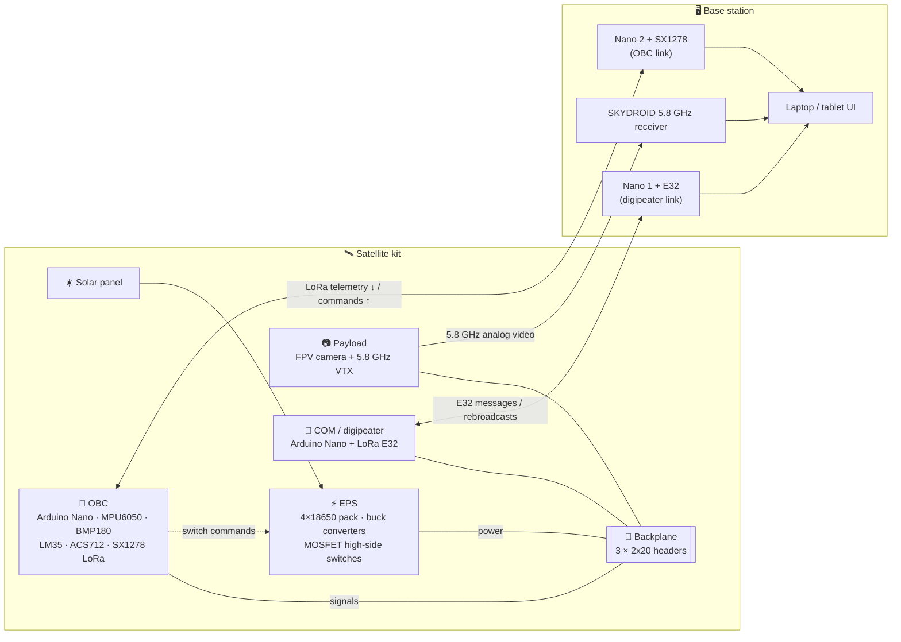
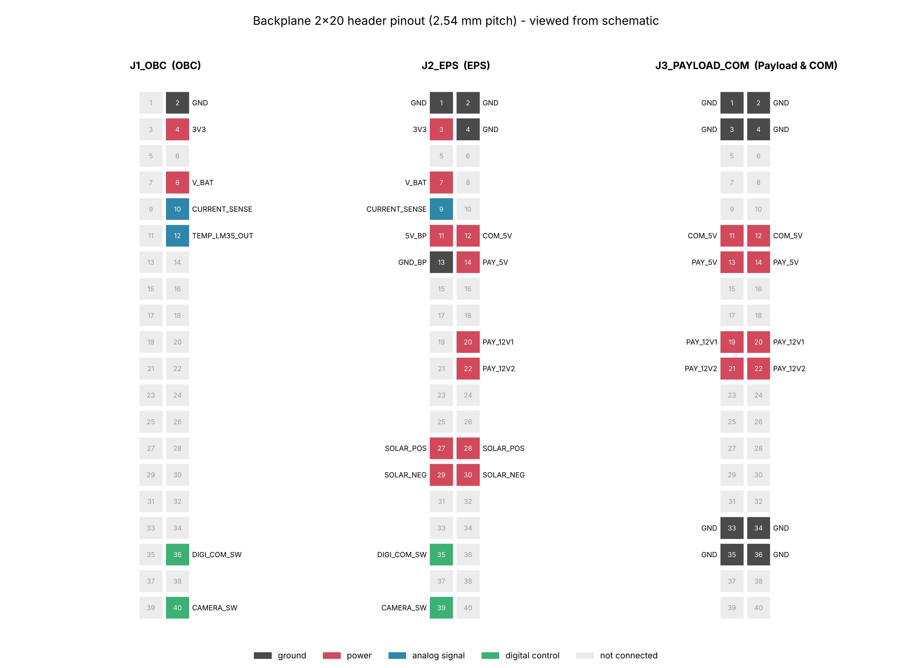

# 🛰️ Satellite Training Kit: a Low-Cost DIY 1U CubeSat

**EEE/ECE383 project, Fall 2023 (BRAC University)**: a hands-on satellite kit built from components available in local Bangladeshi markets, so school and university students can learn how a real satellite works by building one.

<p align="center">
  
  <br><em>The final kit: OBC, EPS and Payload & COM boards plugged into the backplane, with LoRa and 5.8 GHz antennas and the FPV camera.</em>
</p>

## Why this project

Bangladesh has strong electrical and computer engineering talent but very little hands-on access to space technology. Educational resources are scarce and imported kits are expensive. This kit:

- costs around **17,000 BDT** in total, and the satellite side (without the ground station) costs much less;
- uses **locally available parts** such as Arduino Nano, LoRa modules, 18650 cells and MOSFETs;
- is split into **subsystems that mirror a real CubeSat**, so students learn power, computing, communication, payload and integration as separate, connectable modules.

**My role:** I led the project and worked across all five subsystem teams: architecture, subsystem interfaces, PCB design reviews and system integration.

## Mission

1. Establish a radio link with a ground station.
2. Send sensor telemetry (temperature, pressure/altitude, acceleration, rotation, battery voltage and current) to the ground station.
3. Rebroadcast received packets over a wider area (digipeater).
4. Stream live video from an on-board camera.

## Glossary

| Term | Meaning |
|---|---|
| **CubeSat (1U)** | Standard small-satellite format; 1U is a 10 × 10 × 10 cm cube. |
| **OBC** | On-Board Computer. The satellite's brain: reads sensors, packs telemetry and obeys ground commands. |
| **EPS** | Electrical Power System. Battery, solar charging, voltage regulation and power switching. |
| **Payload** | The mission equipment, here a camera with a 5.8 GHz video transmitter. |
| **COM** | Communication subsystem. A LoRa transceiver acting as a **digipeater** (digital repeater) that rebroadcasts packets. |
| **Base station** | The ground station: LoRa receiver, video receiver and a laptop user interface. |
| **Backplane** | The PCB the subsystem boards plug into. It carries power and signals between them. |
| **Telemetry** | Measured data the satellite sends down to the ground. |
| **LoRa** | Long-range, low-power radio modulation (SX1278 and EBYTE E32 modules, 433 MHz). |
| **VTX / FPV** | Video transmitter / first-person-view analog video link at 5.8 GHz. |
| **Buck converter** | DC-DC converter that steps voltage down efficiently (MINI360). |
| **High-side switch** | A switch placed between the supply and the load, so the load is fully unpowered when it's off. |

## System architecture



### How the system works, step by step

1. **Power:** the solar panel and DC jack charge a 4-cell 18650 pack through Schottky diodes. MINI360 buck converters derive the 3.3 V, 5 V and 12 V rails.
2. **Distribution:** every rail reaches its subsystem through the backplane. The OBC is always on. The camera and the digipeater/COM sit behind MOSFET switches.
3. **Sensing:** the OBC reads the MPU6050 and BMP180 over I2C, and the LM35, ACS712 and battery voltage divider through the ADC.
4. **Downlink:** the OBC packs readings into a **44-byte LoRa packet** and sends it to the base station when asked.
5. **Uplink:** between transmissions the OBC listens. A correctly formatted command switches the camera or COM power on or off through the EPS.
6. **Video:** once powered, the camera streams through the 5.8 GHz VTX to the SKYDROID receiver at the base station.
7. **Digipeater:** the COM board receives LoRa messages, adds information, and rebroadcasts them over a wider area.

## Software

| Part | What it does | Location |
|---|---|---|
| OBC firmware | Sensors → 44-byte telemetry frame, command handling, load switching | [`firmware/obc/`](firmware/obc/) |
| Base station firmware (×2) | Nano 2 + SX1278: OBC link · Nano 1 + E32: digipeater link | [`firmware/base_station_obc_link/`](firmware/base_station_obc_link/), [`firmware/base_station_digi_link/`](firmware/base_station_digi_link/) |
| Digipeater firmware | Receives a message, tags it, rebroadcasts it | [`firmware/com_digipeater/`](firmware/com_digipeater/) |
| Ground station console | Live telemetry display, CSV logging, commands | [`ground_station/ground_station.py`](ground_station/ground_station.py) |

The protocol, wiring and build steps are in [`firmware/README.md`](firmware/README.md). Try the ground software without any hardware:

```bash
pip install pyserial
python ground_station/ground_station.py --selftest
```

> The firmware was rewritten in 2026 from the original design, because the 2023 source code wasn't preserved. Pin assignments follow the original PCB schematics. All sketches compile for the Arduino Nano, and the packet format is checked on the PC by the self-test.

## Subsystems

| Subsystem | Key hardware | Documentation |
|---|---|---|
| ⚡ EPS | 4× 18650, MINI360 bucks, IRF9540 + IRF540 switches, Schottky diodes | [docs/eps.md](docs/eps.md) |
| 🧠 OBC | Arduino Nano, SX1278, MPU6050, BMP180, LM35, ACS712 | [docs/obc.md](docs/obc.md) |
| 📷📡 Payload & COM | FPV camera, TS5828L VTX, LoRa E32 1 W, Arduino Nano | [docs/payload-com.md](docs/payload-com.md) |
| 🖥️ Base station | 2× Arduino Nano, SX1278 + E32 LoRa, SKYDROID 5.8 GHz receiver | [docs/base-station.md](docs/base-station.md) |
| 🔌 Backplane | 90 × 90 mm 2-layer PCB, 3× 2x20 female headers, on-board LM35 | [docs/backplane.md](docs/backplane.md) |

## Hardware files and design review

Every board's schematic has been transcribed into connection tables in [`hardware/`](hardware/): OBC, EPS, Payload & COM, base station and backplane. While doing that, I reviewed the 2023 schematics and found several wiring errors. Two examples: a pin shared by two outputs on the OBC, and the Payload & COM Arduino's power wired to data pins. There was also a radio mismatch between the OBC and the base station, which likely explains the LoRa reception problems in the report. Each issue and its fix is in **[docs/design-review.md](docs/design-review.md)**, and the firmware targets the fixed hardware.

## Backplane interconnect

The backplane is where all the subsystems meet. Its pin assignment was rebuilt from the Altium schematic as machine-readable files:
- [`hardware/backplane/backplane_pinout.csv`](hardware/backplane/backplane_pinout.csv) lists all 120 pins.
- [`hardware/backplane/backplane_netlist.csv`](hardware/backplane/backplane_netlist.csv) lists the 15 nets.

<p align="center"></p>

Regenerate the map with `python tools/plot_pinout.py`. It needs matplotlib.

## Cost

| Subsystem | Cost (BDT) |
|---|---|
| EPS | 2,969.33 |
| Payload & COM | 6,300.00 |
| Backplane | 61.32 |
| Base station | 7,700.00 |
| OBC | not costed in the report |
| **Total (excluding OBC)** | **17,030.65** |

Itemised BOMs are in [`bom/`](bom/). The EPS line items add up to 2,969.33 BDT; the original report states 3,024.33 BDT.

## Project status (end of course, December 2023)

- ✅ Schematics and PCB layouts finished for all subsystems (Altium).
- ✅ EPS switching circuit verified in Proteus simulation.
- ✅ Payload (camera to VTX to receiver) tested successfully.
- ✅ OBC firmware written; telemetry reading and command handling demonstrated. (The firmware in this repo is a 2026 rewrite.)
- ✅ Subsystems assembled on the backplane (see photo above).
- ⚠️ COM: LoRa packet reception still had issues at the time of the report. The likely causes and fixes are identified in the [design review](docs/design-review.md).
- 🔜 Next: fabricate the final PCBs, run full end-to-end integration tests, and add long-range link tests.

## Repository structure

```
├── firmware/                 # Arduino code: obc/, com_digipeater/, base_station_obc_link/, base_station_digi_link/
├── ground_station/           # Python console for the laptop (telemetry + commands)
├── docs/                     # one write-up per subsystem + design-review.md
├── hardware/                 # connection tables per board: obc/, eps/, payload-com/, base-station/, backplane/
├── bom/                      # bill of materials per subsystem + cost summary
├── figures/                  # block diagrams, schematics, PCB layouts, 3D views, photos
│   ├── system/  eps/  obc/  payload-com/  base-station/  backplane/
├── tools/                    # plot_pinout.py (pinout map) + protocol_host_test.cpp
└── report/                   # original final report + backplane documentation (PDF)
```

## Possible improvements

- Inter-satellite communication and autonomous operation modes.
- A multilayer backplane with higher-grade connectors for faster signals.
- Thermal management and expansion slots for more payloads.
- Detailed build manual and lesson plans so the kit can be used in classrooms.

## Acknowledgements

Built by the EEE/ECE383 Fall 2023 project teams (EPS, OBC, Payload & COM, Base Station and Backplane) at BRAC University.
