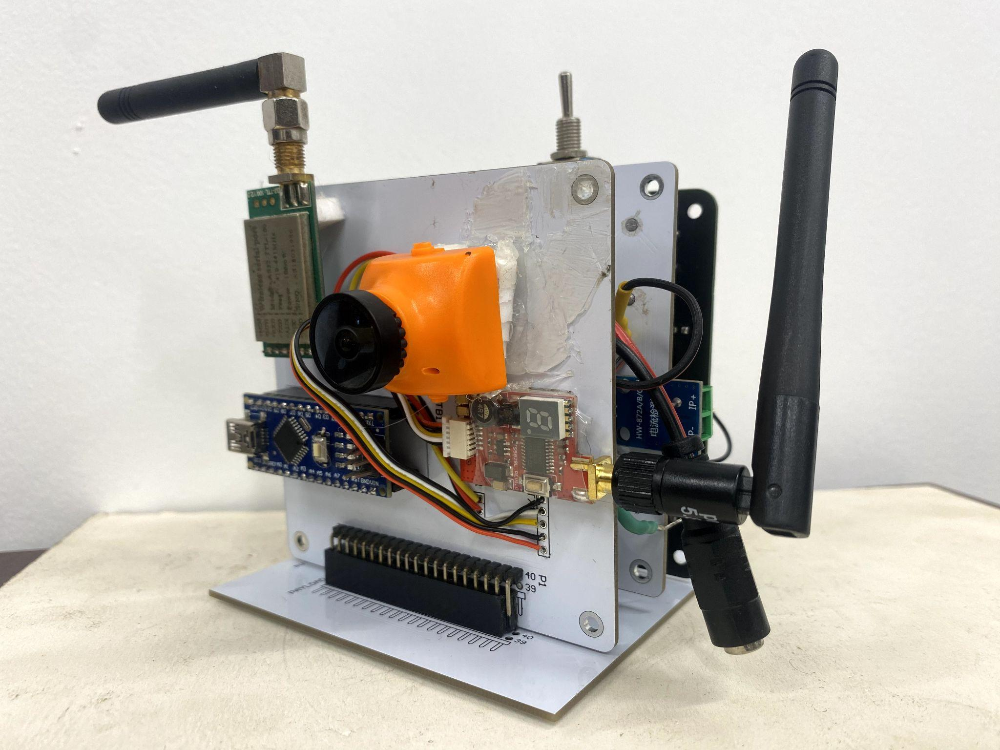
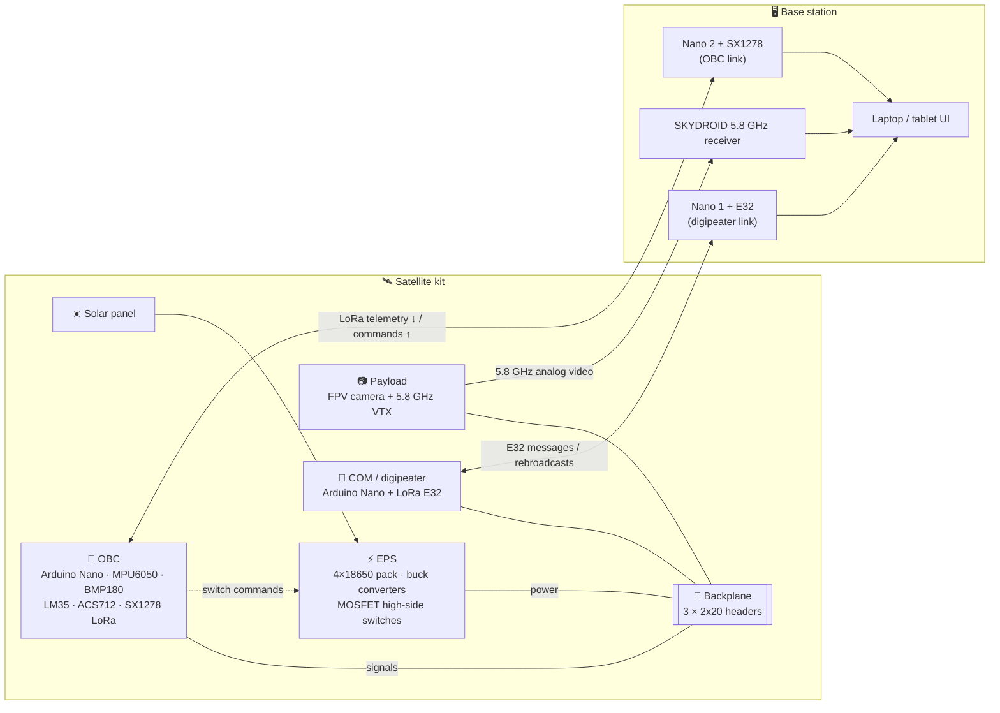

# 🛰️ Satellite Training Kit: a Low-Cost DIY 1U CubeSat

**EEE/ECE383 project, Fall 2023 (BRAC University)**: a hands-on satellite kit built from components available in local Bangladeshi markets, so school and university students can learn how a real satellite works by building one.

  
   <em>The final kit: OBC, EPS and Payload & COM boards plugged into the backplane, with LoRa and 5.8 GHz antennas and the FPV camera.</em>

## Why this project

Bangladesh has strong electrical and computer engineering talent but very little hands-on access to space technology. Educational resources are scarce and imported kits are expensive. This kit:

- costs around **17,000 BDT** in total, and the satellite side (without the ground station) costs much less;
- uses **locally available parts** such as Arduino Nano, LoRa modules, 18650 cells and MOSFETs;
- is split into **subsystems that mirror a real CubeSat**, so students learn power, computing, communication, payload and integration as separate, connectable modules.

## Mission

1. Establish a radio link with a ground station.
2. Send sensor telemetry (temperature, pressure/altitude, acceleration, rotation, battery voltage and current) to the ground station.
3. Rebroadcast received packets over a wider area (digipeater).
4. Stream live video from an on-board camera.

## Specifications

| Term | Meaning |
|---|---|
| **CubeSat (1U)** | Standard small-satellite format; 1U is a 10 × 10 × 10 cm cube. |
| **OBC** | On-Board Computer. The satellite's brain: reads sensors, packs telemetry and obeys ground commands. |
| **EPS** | Electrical Power System. Battery, solar charging, voltage regulation and power switching. |
| **Payload** | The mission equipment, here a camera with a 5.8 GHz video transmitter. |
| **COM** | Communication subsystem. A LoRa transceiver acting as a **digipeater** (digital repeater) that rebroadcasts packets. |
| **Base station** | The ground station: LoRa receiver, video receiver and a laptop user interface. |
| **Backplane** | The PCB the subsystem boards plug into. It carries power and signals between them. |
| **Telemetry** | Measured data the satellite sends down to the ground. |
| **LoRa** | Long-range, low-power radio modulation (SX1278 and EBYTE E32 modules, 433 MHz). |
| **VTX / FPV** | Video transmitter / first-person-view analog video link at 5.8 GHz. |
| **Buck converter** | DC-DC converter that steps voltage down efficiently (MINI360). |
| **High-side switch** | A switch placed between the supply and the load, so the load is fully unpowered when it's off. |

## System architecture

## Subsystems

| Subsystem | Key hardware | Documentation |
|---|---|---|
| ⚡ EPS | 4× 18650, MINI360 bucks, IRF9540 + IRF540 switches, Schottky diodes | [docs/eps.md](docs/eps.md) |
| 🧠 OBC | Arduino Nano, SX1278, MPU6050, BMP180, LM35, ACS712 | [docs/obc.md](docs/obc.md) |
| 📷📡 Payload & COM | FPV camera, TS5828L VTX, LoRa E32 1 W, Arduino Nano | [docs/payload-com.md](docs/payload-com.md) |
| 🖥️ Base station | 2× Arduino Nano, SX1278 + E32 LoRa, SKYDROID 5.8 GHz receiver | [docs/base-station.md](docs/base-station.md) |
| 🔌 Backplane | 90 × 90 mm 2-layer PCB, 3× 2x20 female headers, on-board LM35 | [docs/backplane.md](docs/backplane.md) |

## Cost

| Subsystem | Cost (BDT) |
|---|---|
| EPS | 2,969.33 |
| Payload & COM | 6,300.00 |
| Backplane | 61.32 |
| Base station | 7,700.00 |
| OBC | not costed in the report |
| **Total (excluding OBC)** | **17,030.65** |

## Project status 

- ✅ Schematics and PCB layouts finished for all subsystems (Altium).
- ✅ EPS switching circuit verified in Proteus simulation.
- ✅ Payload (camera to VTX to receiver) tested successfully.
- ✅ OBC firmware written; telemetry reading and command handling demonstrated. (The firmware in this repo is a 2026 rewrite.)
- ✅ Subsystems assembled on the backplane (see photo above).
- 🔜 Next: fabricate the final PCBs, run full end-to-end integration tests, and add long-range link tests.

## Possible improvements

- Inter-satellite communication and autonomous operation modes.
- A multilayer backplane with higher-grade connectors for faster signals.
- Thermal management and expansion slots for more payloads.
- Detailed build manual and lesson plans so the kit can be used in classrooms.

## Acknowledgements

Built by the EEE/ECE383 Fall 2023 project teams (EPS, OBC, Payload & COM, Base Station and Backplane) at BRAC University.
