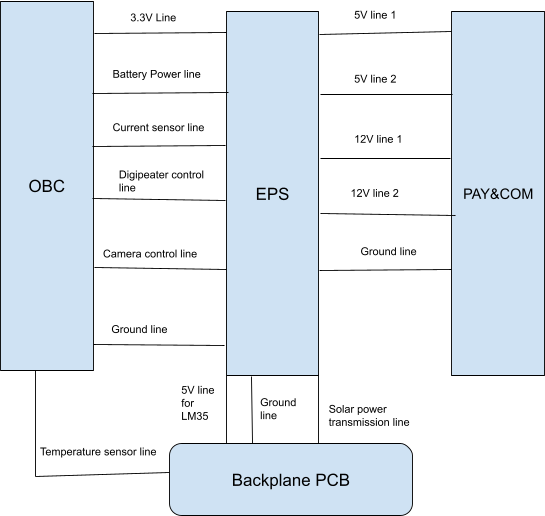
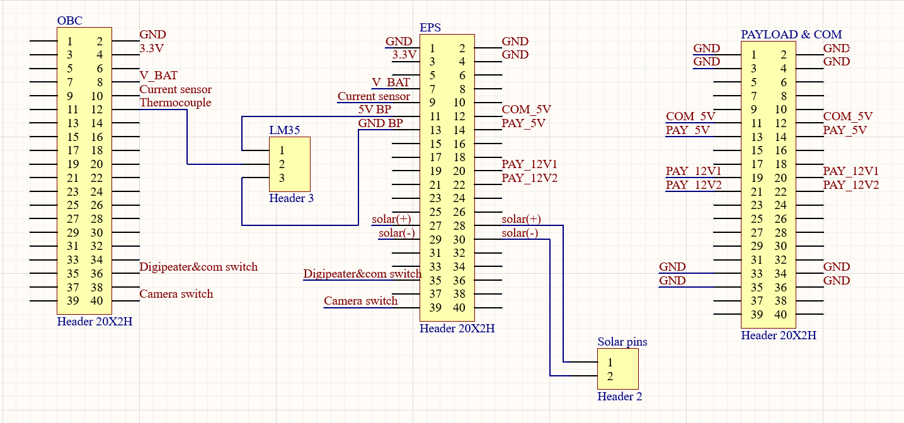
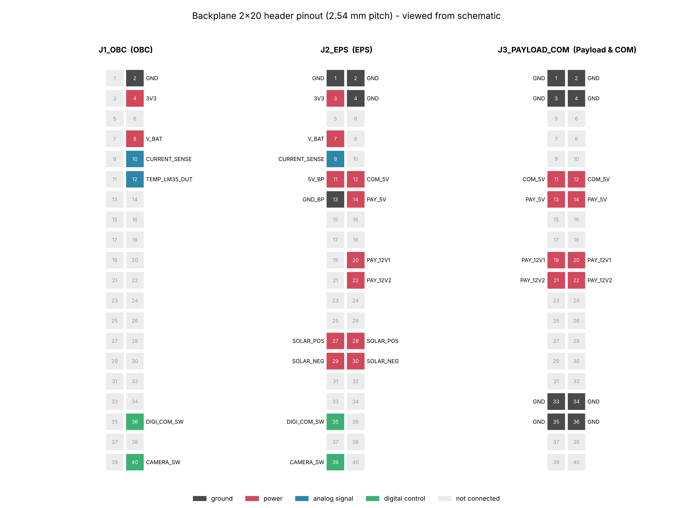
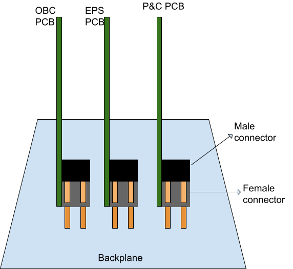
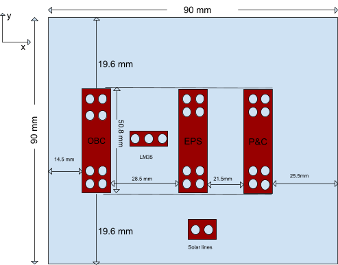
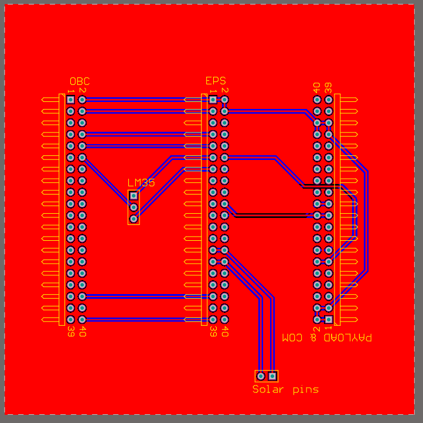
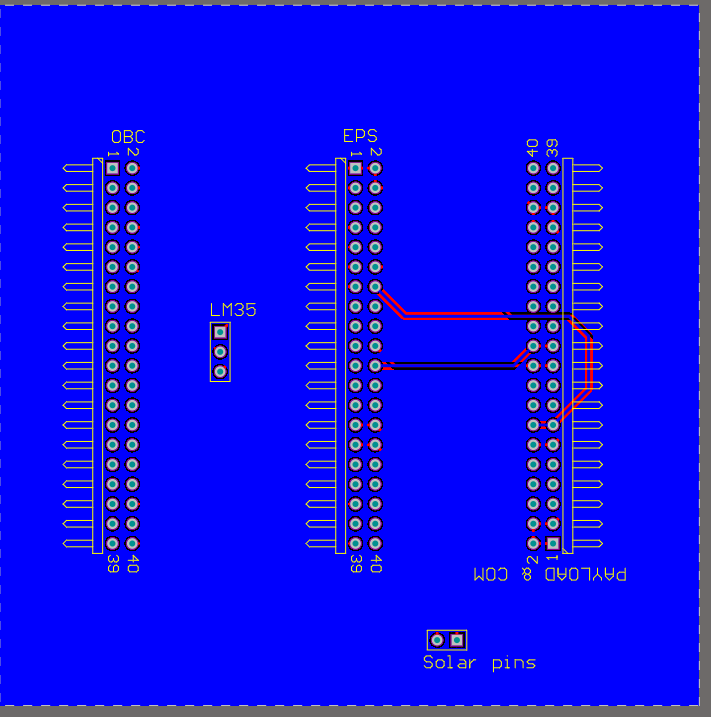
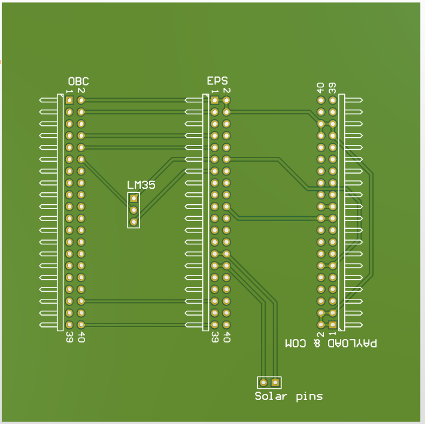

# 🔌 Backplane

The backplane is the physical and electrical backbone of the kit. The OBC, EPS and Payload & COM boards plug into it vertically, and every power rail and control signal between them runs through its traces. An LM35 temperature sensor and the solar input connector are also mounted on it.

## Notation

| Term | Meaning |
|---|---|
| J1 / J2 / J3 | 2x20 female headers for the OBC / EPS / Payload & COM boards |
| J4 | 2-pin solar panel input header |
| U1 | LM35 temperature sensor |
| Pitch | Distance between neighbouring pins (2.54 mm = 0.1 in) |
| mil | 1/1000 inch (0.0254 mm), the unit used for trace widths |
| Net | One electrical connection shared by several pins, e.g. GND |

## Requirements: who needs what from whom

| From → To | Lines |
|---|---|
| EPS → OBC | 3.3 V, direct battery line (V_BAT), current-sensor output, GND |
| OBC → EPS | Digipeater/COM power control, camera power control |
| OBC ← Backplane | LM35 temperature output |
| EPS → Payload & COM | Two 12 V lines, two 5 V lines, GND (no direct OBC ↔ P&C link) |
| EPS ↔ Backplane | Solar + and solar −, 5 V and GND for the LM35 |

## Schematic

## Pinout

Each signal sits **on the same row on both sides** (e.g. OBC pin 8 ↔ EPS pin 7, both V_BAT). This keeps traces short and straight. Each payload rail uses two pins, and P&C has eight ground pins to carry return current.

- Machine-readable files: [`backplane_pinout.csv`](../hardware/backplane/backplane_pinout.csv) (120 pins) and [`backplane_netlist.csv`](../hardware/backplane/backplane_netlist.csv) (15 nets).
- To redraw the map: `python tools/plot_pinout.py`.

## Mechanical design, step by step

| Stacking concept | Placement and dimensions |
|---|---|
|  |  |

1. **Board size:** at most **90 × 90 mm**, so it fits inside the 1U (10 cm) frame. The board has 2 layers.
2. **Connectors:** three **2x20 through-hole female headers**, 2.54 mm pitch, 8 mm body height. Each subsystem board has matching male headers and plugs in vertically.
3. **EPS in the middle:** power flows out to both sides (OBC on the left, P&C on the right), which minimises trace length and crossings.
4. **Unequal spacing:** all three headers sit at the same y-position, but the OBC–EPS gap is wider to make room for the **battery pack**. There is extra space to the right of P&C because the payload board's components face that side.
5. **Trace widths:** **20 mil for power** and **15 mil for signals**. Wider traces carry more current with less voltage drop and heating.
6. **Signal integrity:** routing followed good practice, with short direct paths and solid power and ground planes, to limit crosstalk and impedance mismatch.
7. **Verification:** each subsystem team physically checked header alignment and confirmed the pin-to-pin connections against the pinout document.

## PCB

| Top layer | Bottom layer | 3D view |
|---|---|---|
|  |  |  |

## Bill of materials

See [`bom/backplane_bom.csv`](../bom/backplane_bom.csv). The headers cost 3 × 20.44 = **61.32 BDT**.

## Possible upgrades

More layers if the satellite gains features, higher-grade connectors for faster signals, expansion slots for extra modules, and thermal management.

> The pinout and netlist were rebuilt from the schematic image in the backplane documentation, not exported from the Altium project. Unused pins are floating, as the design intends. In the schematic, `GND_BP` (LM35 ground) is a separate net label from `GND`.
