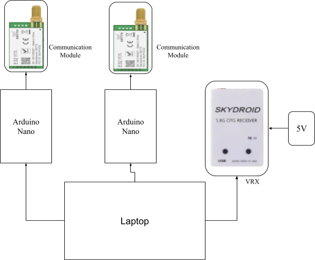
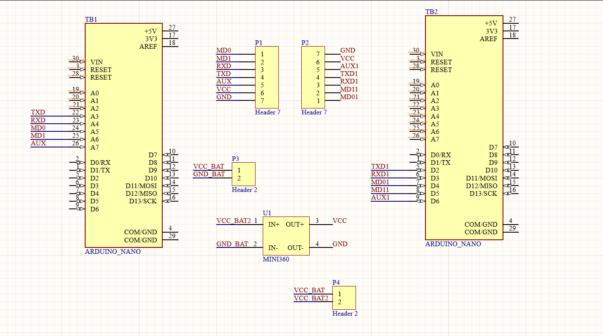
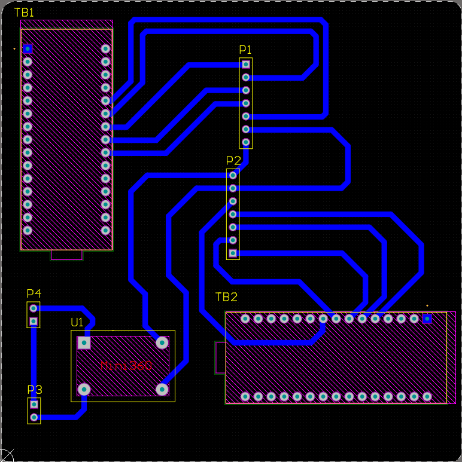

# 🖥️ Base Station (Ground Station)

The base station is the ground side of the link. It receives telemetry and video from the satellite, sends commands up to it, and shows everything on a laptop or tablet.

## Notation

| Term | Meaning |
|---|---|
| Transceiver | A radio that can both transmit and receive |
| SX1278 | Semtech LoRa transceiver chip/module (433 MHz band) |
| SKYDROID | 5.8 GHz dual-antenna FPV video receiver with USB (UVC) output |
| UI | User interface on a laptop or tablet |

## Block diagram

## How it works, step by step

1. **Receive telemetry:** an SX1278 on Nano 2 receives the OBC's 44-byte packets.
2. **Process:** an Arduino decodes the packets and sends the readings to the laptop.
3. **Display:** the UI shows telemetry, signal strength and system status.
4. **Command:** the operator types a command or message (e.g. "Happy Birthday to …"), which the Arduino sends up through LoRa.
5. **Video:** the SKYDROID receiver picks up the 5.8 GHz video and appears on the laptop as a USB camera. It needs a 5 V supply.

## Schematic and PCB

| Schematic | PCB (single layer) |
|---|---|
|  |  |

**Design constraint:** the PCB had to be **single-layer**, because no local fabricator in Bangladesh could make double-layer boards at the time. All routing therefore fits on one copper layer.

## Hardware

The PCB carries two Arduino Nanos (TB1, TB2), two 7-pin E32 sockets (P1, P2), a MINI360 buck converter feeding the radios from a battery input (P3), and a power switch (P4). Full table: [`hardware/base-station/base_station_connections.csv`](../hardware/base-station/base_station_connections.csv).

## Software

- **Nano 1 + E32** (PCB socket P1) → digipeater link: [`firmware/base_station_digi_link/`](../firmware/base_station_digi_link/base_station_digi_link.ino)
- **Nano 2 + SX1278** (jumper-wired; socket P2 left empty) → OBC link: [`firmware/base_station_obc_link/`](../firmware/base_station_obc_link/base_station_obc_link.ino). The OBC carries an SX1278, which an E32 can't reliably talk to ([design review #5](design-review.md)).
- Laptop console: [`ground_station/ground_station.py`](../ground_station/ground_station.py). It shows telemetry, logs it to CSV, and sends commands and messages.

## Bill of materials

See [`bom/base_station_bom.csv`](../bom/base_station_bom.csv). Total: **7,700 BDT**. The SKYDROID receiver alone accounts for 4,800 BDT.

## Status

Hardware acquired. Basic Arduino-to-LoRa communication and the video receiver were tested. A UI prototype with basic layout and navigation was built.
