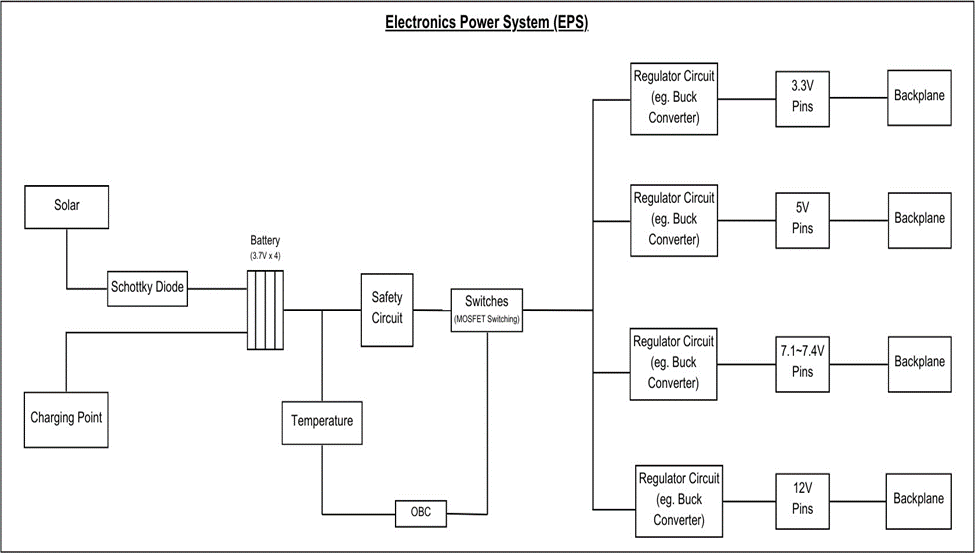
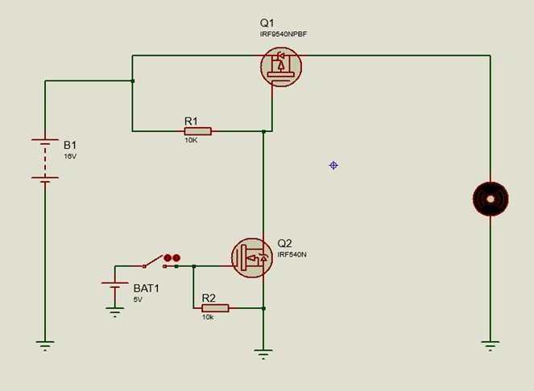
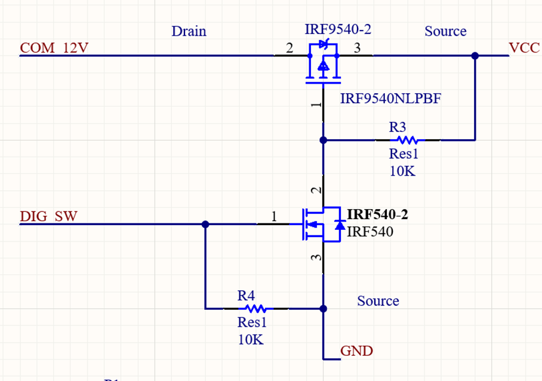
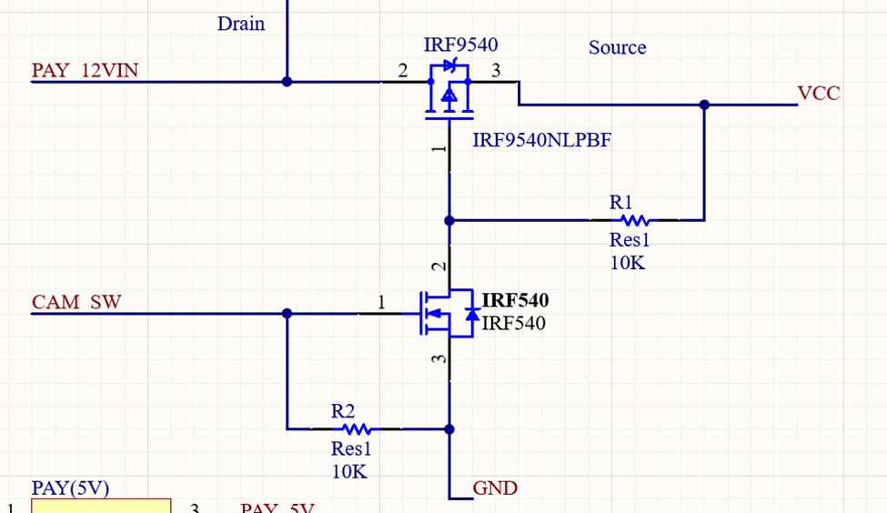
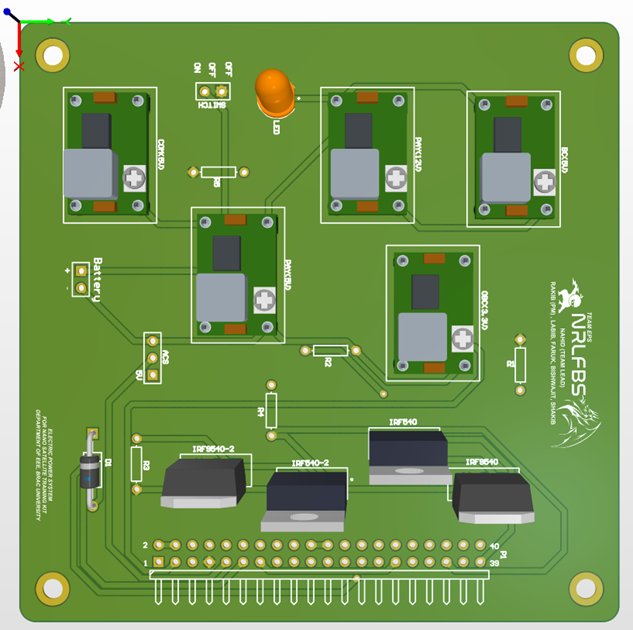
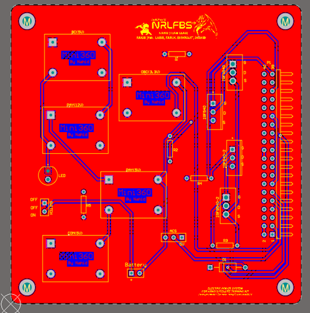
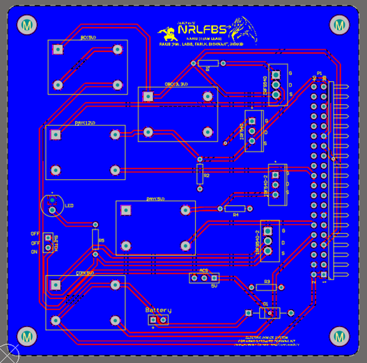

# ⚡ Electrical Power System (EPS)

The EPS generates, stores, regulates and switches power for the whole satellite. It is also the safety layer: nothing downstream of a switch gets power until the OBC allows it.

## Notation

| Symbol | Meaning |
|---|---|
| VBAT | Battery-pack voltage |
| Q1 | IRF9540, P-channel MOSFET (the high-side switch) |
| Q2 | IRF540, N-channel MOSFET (the gate driver) |
| VGS | Gate-to-source voltage of a MOSFET |
| DIG_SW / CAM_SW | 5 V logic signals from the OBC that switch COM and camera power |
| COM_12V, PAY_12VIN | Switched supply outputs to the COM and payload |

## Block diagram

## How it works, step by step

1. **Energy source:** four 3.7 V, 2600 mAh 18650 Li-ion cells, joined with nickel strips, form the pack. With the cells in series, the pack is about 14.8 V nominal and **16.8 V fully charged** (4 × 4.2 V).
2. **Charging:** the pack charges from a **solar panel** or a **DC barrel jack**. A **Schottky diode** in series with the solar panel stops the battery from back-feeding into the panel at night. Schottky diodes have a low forward drop, so little solar power is lost.
3. **Main switch:** an SPDT toggle switch on the positive rail is the master on/off.
4. **Regulation:** five **MINI360 buck converters** step the pack voltage down to the rails the subsystems need: **3.3 V** (OBC), **5 V** (Arduinos, LoRa, LM35) and **12 V** (camera and video transmitter).
5. **Switching:** COM and payload power pass through OBC-controlled **high-side switches**, described below.
6. **Monitoring:** battery voltage (potential divider) and current (ACS712) are passed to the OBC through the backplane. An LED shows the circuit is live.

## High-side MOSFET switch

| Logic simulation (Proteus) | Implementation: COM switch | Implementation: Payload switch |
|---|---|---|
|  |  |  |

1. **Why high-side:** the switch sits between the supply and the load, not between the load and ground. When it's off, the load has no voltage on it at all, which is safer than leaving the load at supply potential.
2. **Q1 (IRF9540, P-channel)** does the switching. A P-MOSFET turns on when its gate is pulled **below** its source, so VGS must be negative. The OBC only outputs 0–5 V and can't drive Q1's gate directly, because Q1's source is at 12 V.
3. **Pull-up keeps it off:** a 10 kΩ resistor ties Q1's gate to its source. By default VGS = 0 and Q1 is **off**.
4. **Q2 (IRF540, N-channel) is the level shifter:** when the OBC drives DIG_SW or CAM_SW to 5 V, Q2 turns on and pulls Q1's gate to ground. Q1 then sees VGS ≈ −12 V and turns **on**, so 12 V reaches the load.
5. **Fail-safe:** a 10 kΩ pull-down on Q2's gate keeps it off if the OBC pin is floating, for example during OBC reset. So by default, everything behind a switch is unpowered.

Netlists: [`hardware/eps/eps_switch_netlist.csv`](../hardware/eps/eps_switch_netlist.csv) (both switches) and [`hardware/eps/eps_power_rails.csv`](../hardware/eps/eps_power_rails.csv) (which rail feeds which board).

## PCB

| 3D view | Top layer (VCC pour) | Bottom layer (GND pour) |
|---|---|---|
|  |  |  |

The board uses copper pours: VCC on the top layer and GND on the bottom layer. Pours lower the resistance of the power paths and give a solid ground reference.

## Bill of materials

See [`bom/eps_bom.csv`](../bom/eps_bom.csv). The line items total **2,969.33 BDT**.

## Status

Circuit verified in Proteus and PCB layout done. Breadboard tests were underway before ordering PCBs from JLCPCB.

> Note: the original report gives the pack maximum as 15.7 V. For four cells in series at 4.2 V each, the correct maximum is 16.8 V.
