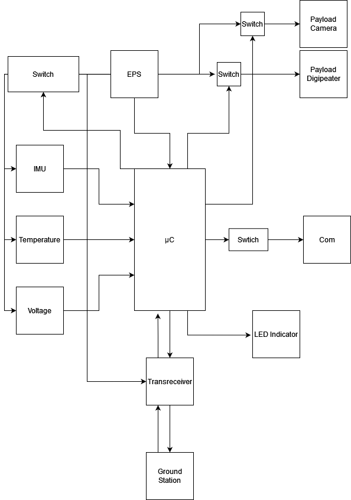
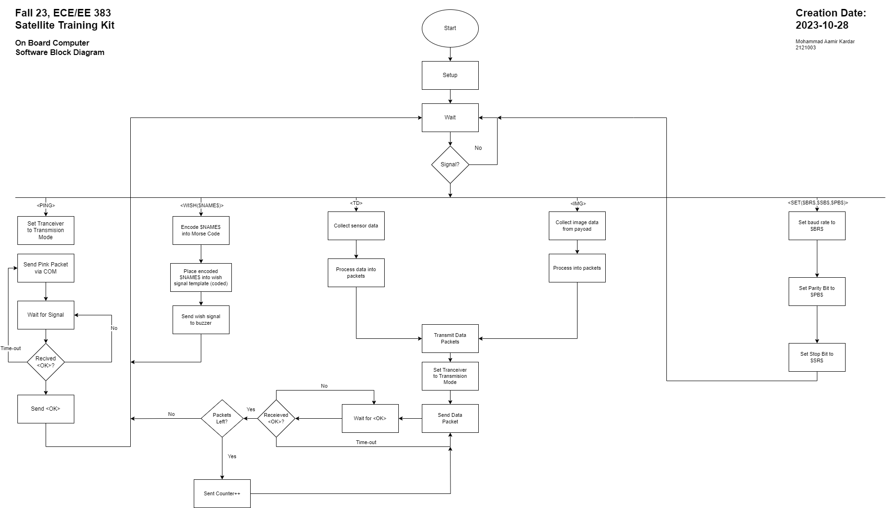
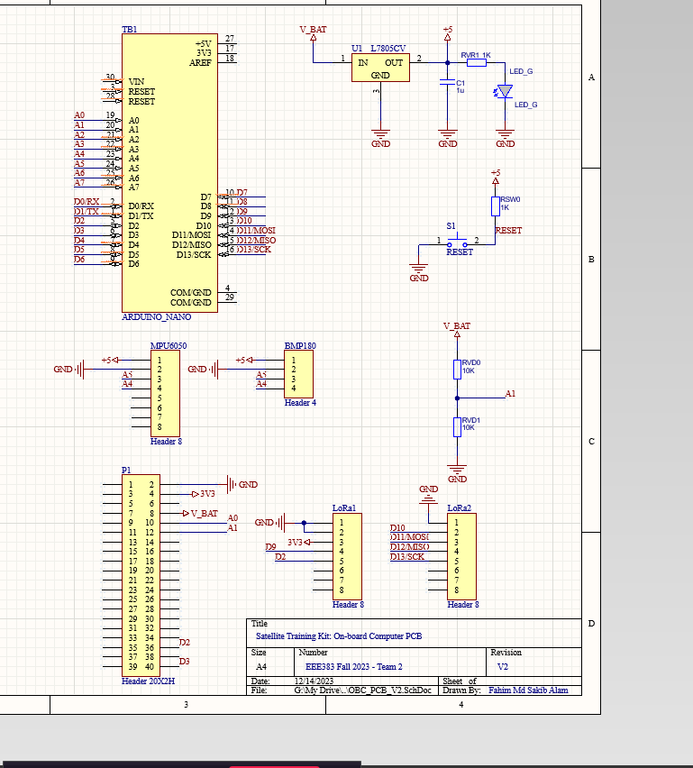
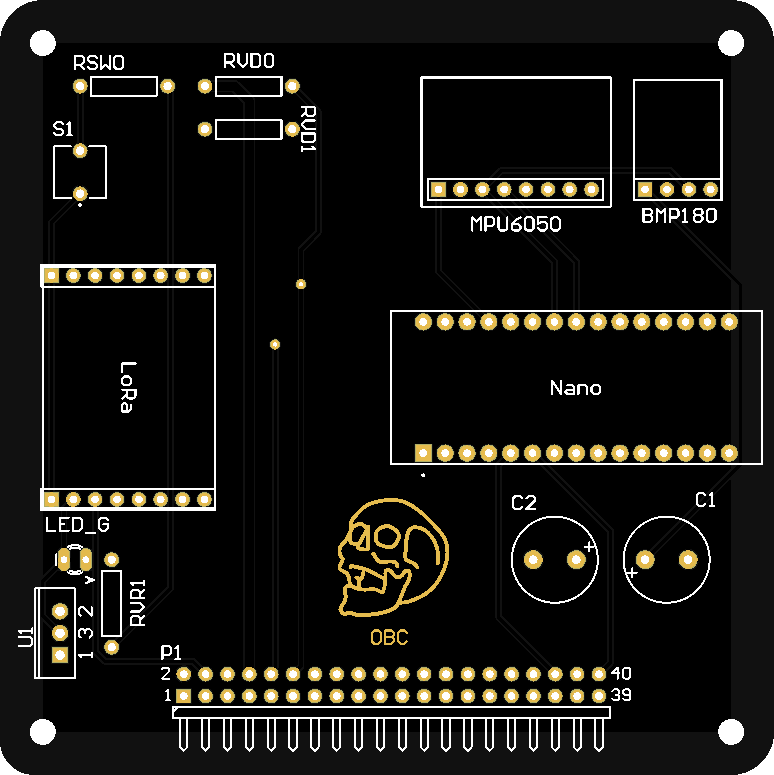

# 🧠 On-Board Computer (OBC)

The OBC is the satellite's brain. It collects telemetry, sends it to the ground station, and carries out commands sent from the ground, including switching other subsystems on and off to save power.

## Notation

| Term | Meaning |
|---|---|
| µC | Microcontroller (Arduino Nano, ATmega328P) |
| I2C | Two-wire digital bus (SDA/SCL) used by the MPU6050 and BMP180 |
| SPI | Four-wire bus used by the SX1278 LoRa module |
| ADC | Analog-to-digital converter input on the Nano, used by the LM35, ACS712 and voltage divider |
| Packet | One 44-byte LoRa frame of telemetry |

## Sensors and interfaces

| Sensor | Measures | Interface |
|---|---|---|
| MPU6050 | Acceleration and rotation (IMU) | I2C |
| BMP180 | Pressure and altitude | I2C |
| LM35 (on backplane) | Temperature | ADC |
| ACS712-5A (via EPS) | Battery current | ADC |
| Potential divider | Battery voltage | ADC |
| SX1278 LoRa | Downlink and uplink radio | SPI |

The full list is in [`bom/obc_components.csv`](../bom/obc_components.csv).

## Hardware block diagram

## How it works, step by step

1. **Boot:** the OBC is powered directly from the EPS (3.3 V and VBAT). It is the only subsystem that is always on.
2. **Collect:** it reads the IMU and barometer over I2C, then the temperature, current and voltage through the ADC.
3. **Pack:** it formats the readings into a **44-byte LoRa packet**, which the base station converts to text.
4. **Transmit:** it sends the packet to the base station when the base station requests it.
5. **Listen:** between transmissions, it waits for commands from the ground.
6. **Act:** when a correctly formatted command arrives, it drives **CAMERA_SW** or **DIGI_COM_SW** high or low. The EPS MOSFET switches then power the camera or the COM/digipeater on or off.

## Software flowchart

## Schematic and PCB

| Schematic | PCB layout |
|---|---|
|  |  |

## Firmware

See [`firmware/obc/obc.ino`](../firmware/obc/obc.ino) and the [protocol description](../firmware/README.md). Pins follow the V2 PCB ([`hardware/obc/obc_connections.csv`](../hardware/obc/obc_connections.csv)): ACS712 → A0, LM35 → A1, battery divider → A2 (after rework), DIGI_COM_SW → D2, CAMERA_SW → D3, SX1278 on D9–D13. The V2 schematic has two pin clashes (D2 and A1); see the [design review](design-review.md).

## Backplane connections (J1)

Pin 2 GND · Pin 4 3V3 · Pin 8 V_BAT · Pin 10 CURRENT_SENSE · Pin 12 TEMP_LM35_OUT · Pin 36 DIGI_COM_SW · Pin 40 CAMERA_SW. See the [full pinout](../hardware/backplane/backplane_pinout.csv).

## Status

PCB designed. Firmware written and demonstrated on a breadboard prototype. Next steps: PCB fabrication and integration testing with the other subsystems.
