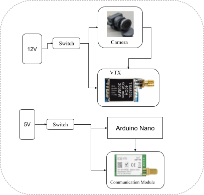
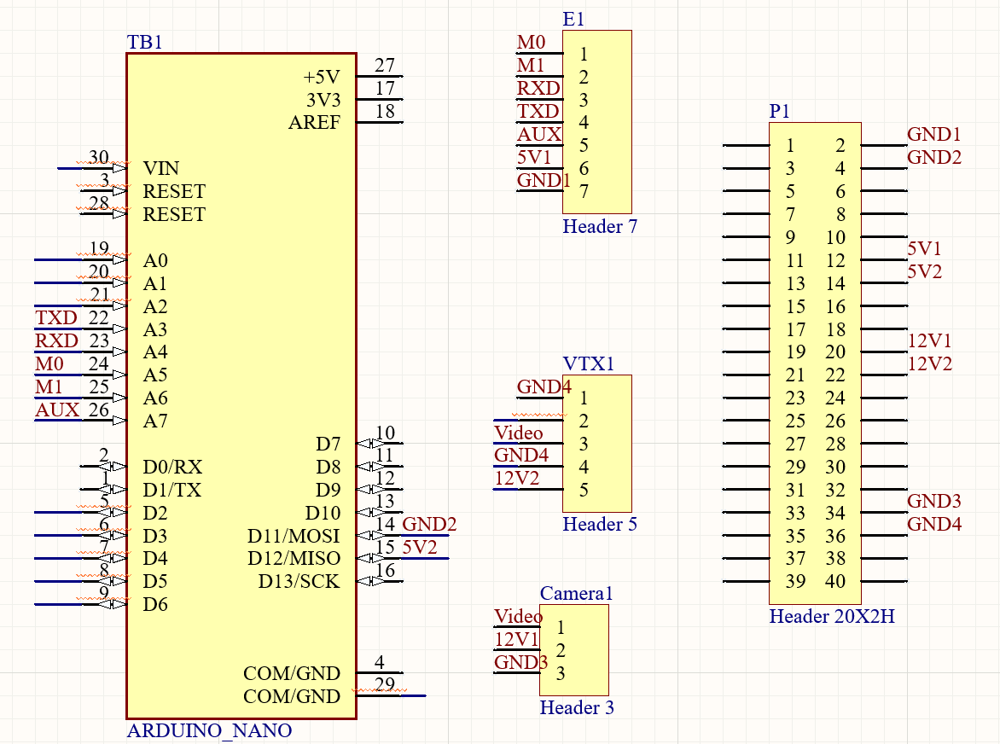
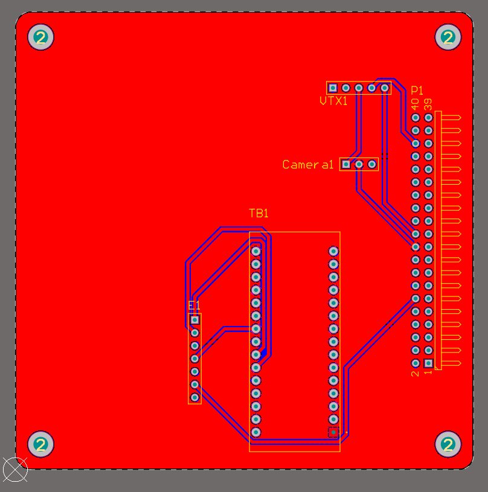
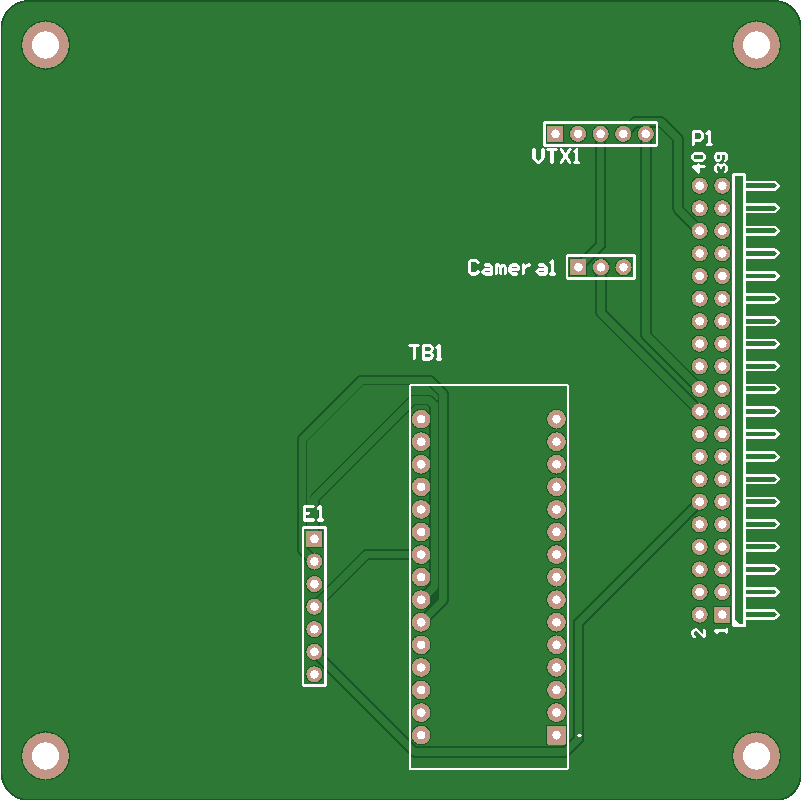
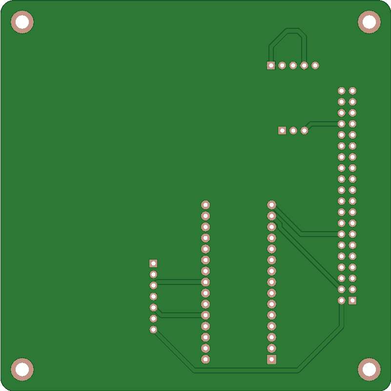

# 📷📡 Payload & Communication

The payload and communication subsystems share one PCB. The **payload** captures and transmits live video. The **COM** subsystem relays LoRa messages as a digipeater, which the report also calls the "Capeater" payload.

## Notation

| Term | Meaning |
|---|---|
| VTX | Video transmitter (TS5828L, 5.8 GHz, 40 channels) |
| FPV | First-person-view analog video system |
| Digipeater | Digital repeater: receives a packet, adds information, and retransmits it |
| LoRa E32 | EBYTE E32-433T30D LoRa module, 1 W (30 dBm), UART interface |
| PAY_12V1 / PAY_12V2 | The two switched 12 V rails from the EPS (camera and VTX) |
| COM_5V / PAY_5V | 5 V rails from the EPS |

## Block diagram

## How it works, step by step

1. **Activation:** the OBC sets CAMERA_SW high, and the EPS switch connects 12 V to the camera and VTX.
2. **Capture:** a 1000TVL CCD mini FPV camera (2.8 mm lens, 110° field of view) produces analog video.
3. **Transmit video:** the TS5828L sends it on a 5.8 GHz channel to the SKYDROID receiver at the base station.
4. **Relay messages:** when the OBC enables DIGI_COM_SW, an Arduino Nano driving the LoRa E32 receives messages, adds information to the message, and broadcasts them over a wide area.

## Schematic and PCB

| Schematic | PCB | Gerber (top) | Gerber (bottom) |
|---|---|---|---|
|  |  |  |  |

## Backplane connections (J3)

GND on pins 1–4 and 33–36 · COM_5V on 11/12 · PAY_5V on 13/14 · PAY_12V1 on 19/20 · PAY_12V2 on 21/22. Each rail uses two pins, which shares the current between them. See the [full pinout](../hardware/backplane/backplane_pinout.csv).

## Firmware

The camera and VTX are analog and need no code. The digipeater runs [`firmware/com_digipeater/com_digipeater.ino`](../firmware/com_digipeater/com_digipeater.ino). Messages that already carry a ` |via ` tag are never repeated, which prevents endless relay loops. Pins follow the PCB: E32 on A3–A7 ([`hardware/payload-com/payload_com_connections.csv`](../hardware/payload-com/payload_com_connections.csv)). The board needs two reworks, the Nano power wiring and the E32 M1 pin; see the [design review](design-review.md).

## Bill of materials

See [`bom/payload_com_bom.csv`](../bom/payload_com_bom.csv). Total: **6,300 BDT**.

## Status

Payload chain tested successfully. The COM side still had trouble receiving LoRa data at the time of the report. PCB ordered.
