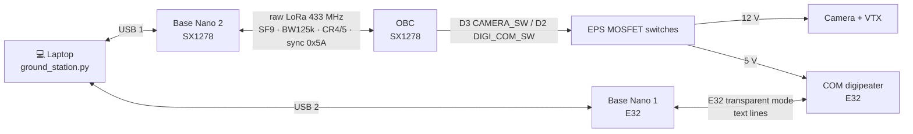
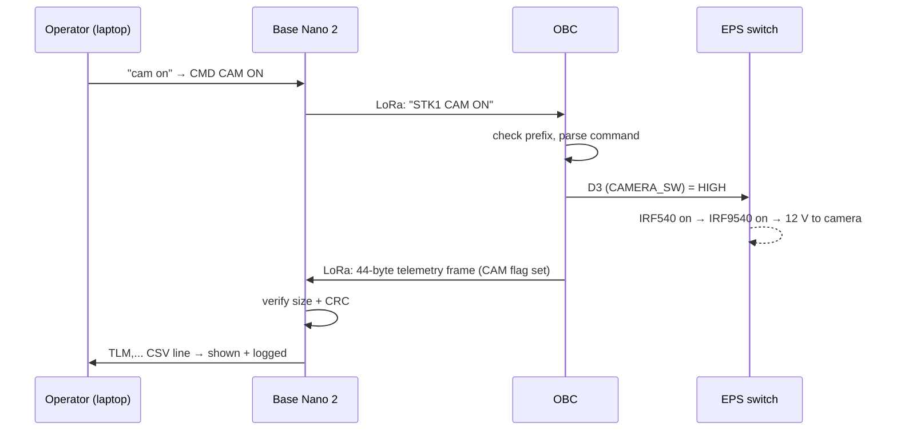

# Firmware

Arduino firmware for the four Arduino Nanos in the system. The EPS is purely analog (buck converters and MOSFET switches), and the camera and video transmitter need no code.

| Folder | Board | Job |
|---|---|---|
| [`obc/`](obc/) | OBC: Nano + SX1278 + MPU6050 + BMP180 | Reads sensors, obeys ground commands, switches loads, sends telemetry |
| [`com_digipeater/`](com_digipeater/) | Payload & COM: Nano + EBYTE E32 1 W | Repeats text messages over a wider area |
| [`base_station_obc_link/`](base_station_obc_link/) | Base station **Nano 2** + SX1278 (USB to laptop) | Sends commands to the OBC, receives telemetry |
| [`base_station_digi_link/`](base_station_digi_link/) | Base station **Nano 1** + E32 (USB to laptop) | Sends messages to the digipeater, shows its re-broadcasts |

The laptop side is [`../ground_station/ground_station.py`](../ground_station/ground_station.py).

> This firmware was rewritten in 2026 from the original design, because the 2023 source code wasn't preserved. Pin assignments follow the original V2 PCB schematics ([`hardware/`](../hardware/)). A few reworks are needed where the schematics have wiring errors; see the [design review](../docs/design-review.md). All four sketches compile for the ATmega328P (Arduino Nano) with avr-gcc. They have not yet been re-tested on the original hardware.

## Notation

| Term | Meaning |
|---|---|
| Uplink / downlink | Ground → satellite / satellite → ground |
| Frame | One radio packet with a fixed layout |
| CRC | Cyclic redundancy check: a 16-bit checksum that detects corrupted frames |
| SF, BW, CR | LoRa spreading factor, bandwidth and coding rate. Both ends must match. |
| RSSI / SNR | Received signal strength (dBm) / signal-to-noise ratio (dB) |
| M0 / M1 / AUX | Mode-select and ready pins of the EBYTE E32 module |
| Polling | Repeatedly asking the radio "has a packet arrived?" instead of waiting for an interrupt pin (DIO0) |

## Radio links



The two links use different radio types on purpose. The OBC carries an **SX1278**, and an E32 can't reliably decode raw SX1278 packets, so base station Nano 2 uses an SX1278 for the OBC link. The digipeater link uses **E32** modules at both ends, as the PCBs were designed. This fixes the radio mismatch in the original design ([design review #5](../docs/design-review.md)).

## Command → response sequence



Step by step:
1. The operator types `cam on` and the laptop sends `CMD CAM ON` to base Nano 2.
2. Nano 2 adds the prefix and transmits `STK1 CAM ON` by LoRa.
3. The OBC ignores anything without the `STK1 ` prefix. This is the "correctly formatted command" check from the report.
4. The OBC sets `CAMERA_SW` (D3) high and the EPS high-side switch powers the camera and VTX.
5. The OBC answers **every** valid command with a fresh telemetry frame, which doubles as an acknowledgement. Its flags show the new switch state.
6. Nano 2 rejects frames with the wrong size or a bad CRC (`BAD,...`) and forwards good ones to the laptop as CSV.

## Commands

| Console | Goes to | Sent over the air | Effect |
|---|---|---|---|
| `tlm` / `ping` | Nano 2 → OBC | `STK1 TLM` / `STK1 PING` | Reply with telemetry only |
| `cam on` / `cam off` | Nano 2 → OBC | `STK1 CAM ON` / `STK1 CAM OFF` | Camera + VTX power |
| `com on` / `com off` | Nano 2 → OBC | `STK1 COM ON` / `STK1 COM OFF` | Digipeater power |
| `all off` | Nano 2 → OBC | `STK1 ALL OFF` | Safe mode |
| `msg <text>` | Nano 1 → digipeater | `<text>` | Message to be repeated |

## Telemetry frame (downlink, 44 bytes, little-endian)

Defined in [`obc/stk_protocol.h`](obc/stk_protocol.h). An identical copy is in `base_station_obc_link/`.

| Offset | Field | Type | Unit / scaling |
|---|---|---|---|
| 0 | sync | uint8 | always `0xA5` |
| 1 | type | uint8 | `0x01` = telemetry |
| 2 | seq | uint16 | frame counter |
| 4 | uptime_ms | uint32 | ms since OBC boot |
| 8 | temp_lm35_cC | int16 | 0.01 °C |
| 10 | temp_bmp_cC | int16 | 0.01 °C |
| 12 | pressure_Pa | int32 | Pa |
| 16 | altitude_cm | int32 | cm (barometric) |
| 20 | accel_raw[3] | int16 ×3 | 16384 LSB/g (±2 g) |
| 26 | gyro_raw[3] | int16 ×3 | 131 LSB/(°/s) (±250 °/s) |
| 32 | vbat_mV | uint16 | mV |
| 34 | ibat_mA | int16 | mA (ACS712) |
| 36 | flags | uint8 | bit0 CAM, bit1 COM, bit2 BMP ok, bit3 IMU ok, bit4 last command rejected |
| 37 | last_cmd_rssi | int8 | dBm |
| 38 | cmd_count | uint16 | accepted commands |
| 40 | reserved | 2 bytes | spare |
| 42 | crc | uint16 | CRC-16/CCITT-FALSE over bytes 0–41 |

Integers are used instead of floats to keep the frame small and to avoid floating-point formatting on the 8-bit microcontroller. The laptop converts them to real units.

## Wiring (from the V2 PCBs)

**OBC Nano**: [`hardware/obc/obc_connections.csv`](../hardware/obc/obc_connections.csv)

| Nano pin | Connects to | Backplane | Note |
|---|---|---|---|
| D10 / D9 | SX1278 NSS / RESET | – | |
| D11 / D12 / D13 | SX1278 MOSI / MISO / SCK | – | |
| (D2) | SX1278 DIO0 | – | **Rework:** leave LoRa1 pin 5 unconnected. The firmware polls. |
| A4 / A5 | SDA / SCL → MPU6050 + BMP180 | – | |
| A0 | ACS712 current sensor | J1 pin 10 | |
| A1 | LM35 temperature | J1 pin 12 | |
| A2 | Battery divider | via J1 pin 8 | **Rework:** move the divider from A1 to A2; RVD0 = 30 kΩ |
| D2 | DIGI_COM_SW | J1 pin 36 | |
| D3 | CAMERA_SW | J1 pin 40 | |
| D4 | Status LED (optional) | – | Not on the V2 PCB |

**Payload & COM Nano (digipeater)** and **base station Nano 1**: same E32 wiring on both PCBs.

| Nano pin | E32 pin | Note |
|---|---|---|
| A3 | TXD | SoftwareSerial RX |
| A4 | RXD | SoftwareSerial TX |
| A5 | M0 | Driven LOW |
| A6 | M1 | **Rework:** A6 can't drive outputs, so tie M1 to GND |
| A7 | AUX | Read with `analogRead()` |

The Payload & COM board also needs its **Nano power rework**: 5V2 → +5V pin, GND2 → GND pin ([design review #4](../docs/design-review.md)).

**Base station Nano 2**: SX1278 by jumper wires: D10 NSS, D9 RESET, D11 MOSI, D12 MISO, D13 SCK, 3V3, GND. The E32 socket P2 stays empty.

⚠️ The **SX1278 is a 3.3 V part**. Power it from 3.3 V and level-shift the Nano's 5 V outputs (NSS, SCK, MOSI, RESET). Check whether your E32 module's UART is 3.3 V; if so, put a resistor divider on the Arduino TX line.

## Building and uploading

1. Install the [Arduino IDE](https://www.arduino.cc/en/software).
2. In **Library Manager**, install **LoRa** (by Sandeep Mistry) and **Adafruit BMP085 Library**. Accept the Adafruit BusIO dependency when asked.
3. Open a sketch, e.g. `obc/obc.ino`, and select **Tools → Board → Arduino Nano**. For clone boards, set **Processor → ATmega328P (Old Bootloader)**.
4. Upload, then open the Serial Monitor at **115200** baud to see debug output.
5. Repeat for the other three sketches. Label the two base-station Nanos so you know which USB port is which.

Memory use on the ATmega328P:

| Sketch | Flash | RAM |
|---|---|---|
| obc | 16,972 B (52%) | 623 B (30%) |
| com_digipeater | 5,788 B (18%) | 445 B (22%) |
| base_station_obc_link | 9,462 B (29%) | 409 B (20%) |
| base_station_digi_link | 4,804 B (15%) | 534 B (26%) |

## Running the ground station

```bash
pip install pyserial
python ground_station/ground_station.py --obc-port COM5 --digi-port COM6
```
On Linux or macOS the ports look like `/dev/ttyUSB0`. Either port can be left out. Run `--selftest` to try it without hardware.

## Calibration

Edit the constants at the top of `obc.ino`:
- `VBAT_DIVIDER`: 4.0 for the reworked 30k/10k divider (16.8 V → 4.2 V at the ADC).
- `ACS712_V_PER_A`: 0.185 for the 5 A version, 0.100 for 20 A, 0.066 for 30 A.
- `SEA_LEVEL_PA`: local sea-level pressure, for accurate altitude.
- `BEACON_MS`: set it above 0 to also send telemetry periodically without being asked.
