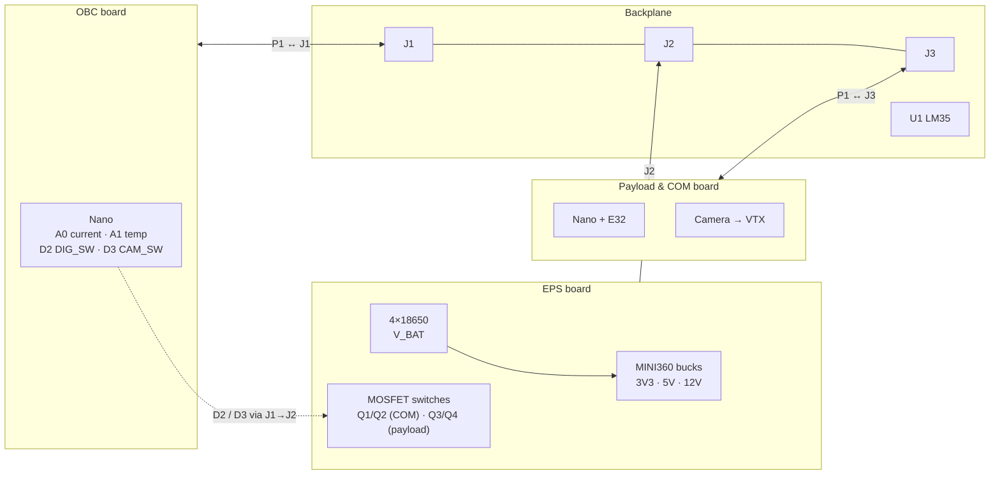

# Hardware

Machine-readable connection tables for every subsystem board, transcribed from the Altium schematics in the [final report](../report/). Each table lists every component pin and the net it connects to, so the boards can be checked, rebuilt or compared against the firmware.

| Folder | Board | Files | Schematic |
|---|---|---|---|
| [`obc/`](obc/) | On-Board Computer (Arduino Nano, SX1278, MPU6050, BMP180, L7805) | `obc_connections.csv` | [image](../figures/obc/obc_schematic.png) |
| [`eps/`](eps/) | Electrical Power System | `eps_switch_netlist.csv`, `eps_power_rails.csv` | [COM switch](../figures/eps/switching_circuit_com.png), [payload switch](../figures/eps/switching_circuit_payload.png) |
| [`payload-com/`](payload-com/) | Payload & COM (Arduino Nano, E32, camera, VTX) | `payload_com_connections.csv` | [image](../figures/payload-com/payload_com_schematic.png) |
| [`base-station/`](base-station/) | Base station (2× Arduino Nano, E32 headers, MINI360) | `base_station_connections.csv` | [image](../figures/base-station/base_station_schematic.png) |
| [`backplane/`](backplane/) | Backplane (3× 2x20 headers, LM35) | `backplane_pinout.csv`, `backplane_netlist.csv` | [image](../figures/backplane/backplane_schematic.png) |

## Notation

| Term | Meaning |
|---|---|
| **Designator** | Component reference on the schematic: TB1 = Arduino Nano, U1 = regulator, P1 = 2x20 backplane header, Q = MOSFET, R = resistor |
| **Pin** | Physical pin number on that component, as shown on the schematic symbol |
| **Net** | Name of the electrical connection. Pins with the same net name are connected. |
| **J1 / J2 / J3** | Backplane headers for the OBC / EPS / Payload & COM boards. Each board's own **P1** header plugs into one of them. |

## How the boards connect

## How these files were made

1. The schematic images were zoomed in and every net label was read against the wire directly below it. That is the label convention used throughout these schematics.
2. Each connection was cross-checked across boards. For example, the OBC's P1 pin 36 (`D2`) must line up with backplane J1 pin 36 (`DIGI_COM_SW`) and EPS J2 pin 35. Every subsystem matched the backplane pinout.
3. Anything that looks wrong or unconnected is marked in the `note` column and explained in the [design review](../docs/design-review.md).

> These are transcriptions of schematic images, not exports from the original Altium projects, which were not preserved. Check against the images before fabricating anything.
